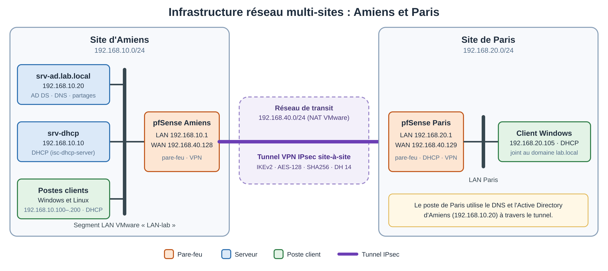

# Infrastructure réseau multi-sites — pfSense, VPN IPsec, Active Directory et DHCP

> Laboratoire personnel virtualisé (VMware Workstation) : deux sites, un VPN IPsec site-à-site, un domaine Active Directory, du DHCP et des stratégies de groupe.

## Présentation

Ce projet consiste à construire et administrer une infrastructure informatique répartie sur deux sites fictifs : **Amiens** et **Paris**. Les deux réseaux locaux sont interconnectés par un **VPN IPsec site-à-site** entre deux pare-feu **pfSense**.

Le site d'Amiens héberge le contrôleur de domaine **Active Directory** (avec le DNS du domaine `lab.local`) et un serveur **DHCP** Linux. Le site de Paris dispose de son propre réseau et de son DHCP assuré par pfSense. Un poste Windows situé à Paris est joint au domaine et utilise les services centralisés d'Amiens à travers le tunnel.

Le projet couvre aussi l'administration des comptes, groupes et unités d'organisation, **10 stratégies de groupe (GPO)**, les profils itinérants, et les partages réseau avec permissions SMB et NTFS.

## Objectifs

- Concevoir un réseau d'entreprise réparti sur deux sites, avec des sous-réseaux IPv4 distincts.
- Interconnecter les sites avec un VPN IPsec.
- Centraliser l'identité et l'authentification avec Active Directory.
- Fournir la résolution de noms (DNS) et la configuration automatique des postes (DHCP).
- Administrer utilisateurs et postes par groupes, OU et GPO (sécurité et configuration).
- Mettre à disposition des profils itinérants et des partages avec contrôle d'accès.
- Attribuer automatiquement des lecteurs réseau selon l'appartenance aux groupes AD.

## Architecture logique



## Plan d'adressage

| Élément | Adresse / réseau |
|---|---|
| LAN Amiens | `192.168.10.0/24` |
| Passerelle Amiens (pfSense) | `192.168.10.1` |
| Serveur DHCP `srv-dhcp` | `192.168.10.10` |
| Serveur AD/DNS `srv-ad` | `192.168.10.20` |
| Pool DHCP Amiens | `192.168.10.100` – `192.168.10.200` |
| WAN pfSense Amiens / Paris (transit) | `192.168.40.128` / `192.168.40.129` |
| LAN Paris | `192.168.20.0/24` |
| Passerelle Paris (pfSense) | `192.168.20.1` |
| Pool DHCP Paris | `192.168.20.104` – `192.168.20.200` |
| Domaine Active Directory | `lab.local` |

## Services et composants

| Composant | Rôle |
|---|---|
| pfSense Amiens (`2.9.0`) | Pare-feu, routage et terminaison VPN du site d'Amiens |
| pfSense Paris (`2.9.0`) | Pare-feu, routage, DHCP local et terminaison VPN du site de Paris |
| Windows Server 2022 `srv-ad` | Active Directory Domain Services, DNS, partages de fichiers |
| Ubuntu Server 26.04 LTS `srv-dhcp` | Serveur DHCP du site d'Amiens (`isc-dhcp-server`) |
| Clients Amiens (Windows et Linux) | Postes de test recevant leur configuration par DHCP |
| Client Windows Paris | Poste joint au domaine `lab.local` à travers le VPN |
|  GPO | Fonds d'écran (IT, RH), mots de passe, verrouillage, USB, écran de veille, Panneau de configuration, Gestionnaire des tâches, lecteurs réseau, profils itinérants |

## Choix de conception notables

- **Le DNS du domaine est géré par Active Directory**
- **Un DHCP par site**, distribuant tous deux le DNS d'Active Directory.
- **Droits attribués à des groupes** (`GG_IT`, `GG_RH`, `GG_Direction`) plutôt qu'à des utilisateurs, combinés entre permissions de partage et NTFS.

## Compétences mises en œuvre

| Domaine | Mise en œuvre |
|---|---|
| Réseau | Plan d'adressage IPv4, sous-réseaux `/24`, routage inter-sites, NAT |
| Sécurité réseau | Pare-feu pfSense, règles WAN / LAN / IPsec, VPN IPsec IKEv2 (AES 128, SHA256, DH 14) |
| Services réseau | DHCP (`isc-dhcp-server` et pfSense), DNS d'Active Directory, enregistrements SRV |
| Windows Server | Active Directory (OU, utilisateurs, groupes), GPO et préférences, profils itinérants, partages SMB et permissions NTFS |
| Linux | Ubuntu Server 26.04 LTS, Netplan, administration de services (`systemctl`, `journalctl`) |
| Virtualisation | VMware Workstation, segments LAN, réseau NAT |
| Diagnostic | `ping`, `nslookup`, `ipconfig`, `gpresult`, `gpupdate`, `net accounts`, `icacls`, `Get-SmbShareAccess`, état du tunnel IPsec |
| Documentation | Markdown, schémas Mermaid, captures commentées |

## Documentation

| N° | Document | Contenu |
|---|---|---|
| 01 | [Architecture réseau](documentation/01-architecture-reseau.md) | Topologie, plan d'adressage, rôles |
| 02 | [pfSense et routage](documentation/02-pfsense-et-routage.md) | Interfaces, routage, filtrage |
| 03 | [VPN IPsec](documentation/03-vpn-ipsec.md) | Tunnel site-à-site |
| 04 | [Active Directory et DNS](documentation/04-active-directory-et-dns.md) | Domaine, OU, groupes, DNS |
| 05 | [DHCP](documentation/05-dhcp.md) | `isc-dhcp-server` (Amiens) et pfSense (Paris) |
| 06 | [GPO et administration](documentation/06-gpo-et-administration.md) | Inventaire et détail des 10 GPO |
| 07 | [Profils itinérants](documentation/07-profils-itinerants.md) | Profils hébergés sur `srv-ad` |
| 08 | [Partages et permissions](documentation/08-partages-et-permissions.md) | SMB + NTFS |
| 09 | [Mappage des lecteurs](documentation/09-mappage-des-lecteurs.md) | GPP et ciblage par groupe |
| 10 | [Tests et validation](documentation/10-tests-et-validation.md) | Tests et synthèse |
| 11 | [Évolutions et leçons](documentation/11-evolutions-et-lecons.md) | Problèmes rencontrés, décisions |

Les fichiers de configuration sont dans [`configs/`](configs/), le schéma dans [`schemas/`](schemas/).

## Organisation du dépôt

```text
infrastructure-reseau-multi-sites/
├── README.md
├── documentation/
│   ├── 01-architecture-reseau.md
│   ├── 02-pfsense-et-routage.md
│   ├── 03-vpn-ipsec.md
│   ├── 04-active-directory-et-dns.md
│   ├── 05-dhcp.md
│   ├── 06-gpo-et-administration.md
│   ├── 07-profils-itinerants.md
│   ├── 08-partages-et-permissions.md
│   ├── 09-mappage-des-lecteurs.md
│   ├── 10-tests-et-validation.md
│   └── 11-evolutions-et-lecons.md
└── captures/
    ├── README.md
    ├── 01-reseau/
    ├── 02-pfsense/
    ├── 03-vpn-ipsec/
    ├── 04-active-directory-dns/
    ├── 05-dhcp/
    ├── 06-gpo/
    └── 07-profils-partages/
```

## Résultats obtenus

- Tunnel VPN IPsec entre Amiens et Paris (IKEv2, AES 128, SHA256, DH 14) configuré, établi, avec du trafic observé dans les deux sens.
- Le client de Paris communique avec le serveur AD/DNS d'Amiens et a rejoint le domaine `lab.local`.
- DHCP opérationnel sur les deux sites : `isc-dhcp-server` à Amiens, pfSense à Paris.
- GPO de sécurité et de configuration appliquées (voir document 06) ; politique de mots de passe et de verrouillage vérifiée avec `net accounts /domain` après correction de la priorité des GPO.
- Partages accessibles depuis Paris à travers le VPN : un utilisateur voit les dossiers, mais n'ouvre que celui de son groupe.
- Lecteurs réseau attribués automatiquement selon l'appartenance aux groupes de sécurité.

## Limites et périmètre

Le laboratoire ne comporte pas de second contrôleur de domaine : `srv-ad` est un point unique de dépendance pour Active Directory et DNS. La haute disponibilité, la sauvegarde/restauration documentée et la supervision centralisée ne sont pas présentées comme réalisées.

Les règles de pare-feu entre les deux LAN sont volontairement larges (tous protocoles) dans ce laboratoire, et le partage des profils est ouvert à Tout le monde au niveau du partage ; ces points sont listés comme pistes d'amélioration dans le document 11.

Un détail n'est pas documenté : les paramètres détaillés de la GPO `GPO-ProfilsItinerants`.

## Sécurité

Ce dépôt ne contient ni clé prépartagée IPsec, ni mot de passe, ni sauvegarde de configuration pfSense ou Windows. Les captures sont publiées telles quelles : elles peuvent montrer des noms de comptes et de machines du laboratoire, ainsi que des adresses privées. Les adresses du laboratoire sont toutes privées.

## Auteur et contexte

Projet personnel d'Amine Djabri, réalisé dans le cadre de la Licence Pro MRIT — Cybersécurité des Systèmes Industriels (IFALP), pour mettre en pratique l'administration systèmes et réseaux dans un environnement virtualisé. Les noms de sites, de domaine et les plages d'adresses sont ceux du laboratoire.
