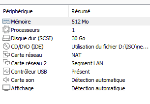
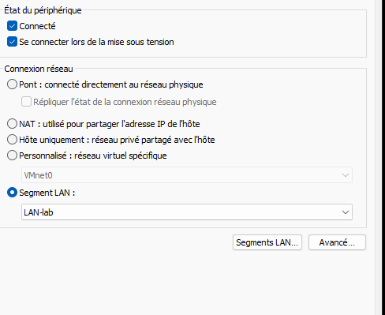
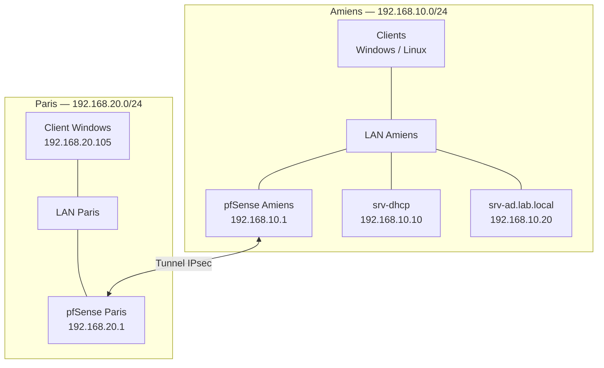

# 01 — Architecture réseau

## 1. Contexte

Le laboratoire représente une entreprise disposant de deux implantations : Amiens et Paris. Chaque site possède un réseau local distinct, connecté à un pare-feu pfSense. Les deux pare-feu établissent un tunnel VPN IPsec site-à-site pour permettre les communications privées entre les sous-réseaux.

Le site d'Amiens héberge les services centraux : annuaire et DNS (`srv-ad`), et DHCP (`srv-dhcp`). Le site de Paris héberge un poste client Windows qui rejoint le domaine et accède aux ressources centralisées à travers le VPN.

## 2. Environnement de virtualisation

| Élément | Valeur |
|---|---|
| Hyperviseur | VMware Workstation |
| Réseau LAN d'Amiens | Segment LAN VMware `LAN-lab` (commutateur virtuel isolé) |
| Accès Internet | NAT VMware, utilisé temporairement pour installer des paquets |
| Réseau de transit entre les pfSense | `192.168.40.0/24` (réseau NAT de VMware, carte WAN de chaque pfSense) |
| Serveur Windows | Windows Server 2022 (`srv-ad`) |
| Serveur Linux | Ubuntu Server 26.04 LTS (`srv-dhcp`) |
| Pare-feu | pfSense `2.9.0-RELEASE` (deux instances : Amiens et Paris) |

*Configuration VMware d'une VM pfSense : carte réseau 1 en NAT (WAN) et carte réseau 2 sur un segment LAN.*

*Carte réseau 2 en mode « Segment LAN » : segment `LAN-lab`.*

## 3. Topologie

## 4. Plan d'adressage

| Site / équipement | Adresse |
|---|---|
| Réseau Amiens | `192.168.10.0/24` |
| Passerelle Amiens | `192.168.10.1` |
| WAN pfSense Amiens (transit) | `192.168.40.128` |
| WAN pfSense Paris (transit) | `192.168.40.129` |
| Serveur DHCP `srv-dhcp` | `192.168.10.10/24` |
| Serveur AD/DNS `srv-ad` | `192.168.10.20/24` |
| Pool DHCP Amiens | `192.168.10.100` – `192.168.10.200` |
| Réseau Paris | `192.168.20.0/24` |
| Passerelle Paris | `192.168.20.1` |

Les deux réseaux utilisent chacun un préfixe `/24`, soit le masque `255.255.255.0`. Les serveurs ont des adresses fixes, hors du pool DHCP.

## 5. Rôles des équipements

- **pfSense Amiens :** passerelle du LAN Amiens, filtrage et terminaison du VPN.
- **pfSense Paris :** passerelle du LAN Paris, service DHCP du site et terminaison du VPN.
- **srv-ad :** contrôleur de domaine, serveur DNS du domaine `lab.local` et serveur de fichiers.
- **srv-dhcp :** serveur DHCP du site d'Amiens (rôle unique ; il ne fait pas de DNS).
- **Clients Amiens :** postes de test obtenant leur configuration par DHCP.
- **Client Windows Paris :** poste membre du domaine, utilisant les services AD/DNS d'Amiens.

## 6. Flux fonctionnels attendus

- Le client Paris joint sa passerelle locale `192.168.20.1`.
- Le client Paris atteint le serveur `192.168.10.20` à travers le VPN.
- La résolution DNS de `lab.local` est assurée par le DNS d'Active Directory (`192.168.10.20`), pour les deux sites.
- Les ressources SMB du serveur sont accessibles depuis Paris si les règles de pare-feu et les autorisations le permettent.

## 7. Éléments non documentés

- Le segment LAN VMware utilisé par le site de Paris n'est pas précisé (les captures VMware concernent une VM pfSense dont la carte 2 est sur `LAN-lab`).
- Les modes réseau des cartes virtuelles des autres VM ne sont pas détaillés.

Les détails des interfaces, du filtrage et du tunnel sont dans [02 — pfSense et routage](02-pfsense-et-routage.md) et [03 — VPN IPsec](03-vpn-ipsec.md). Ce dépôt ne publie ni adresse publique, ni secret, ni identifiant de connexion.
