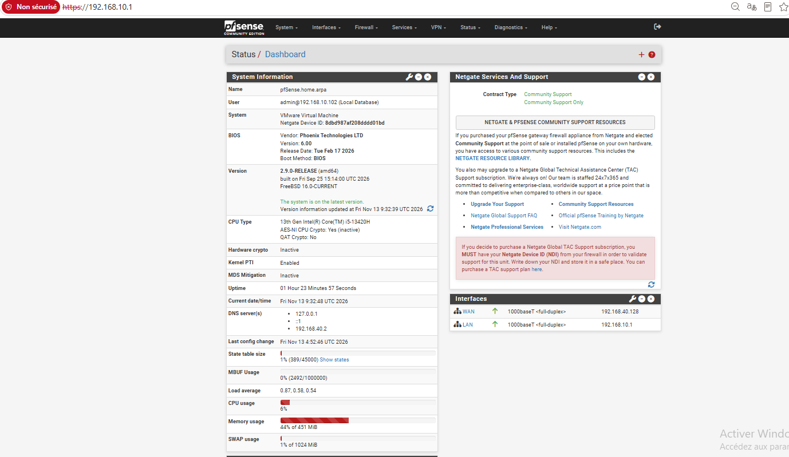
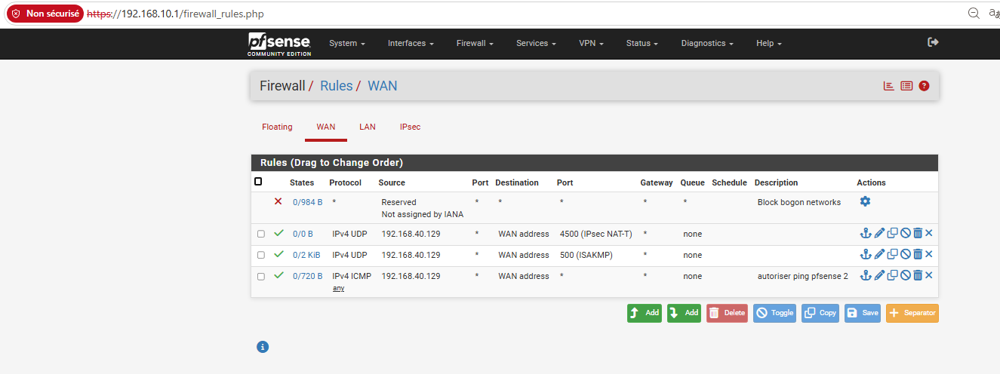
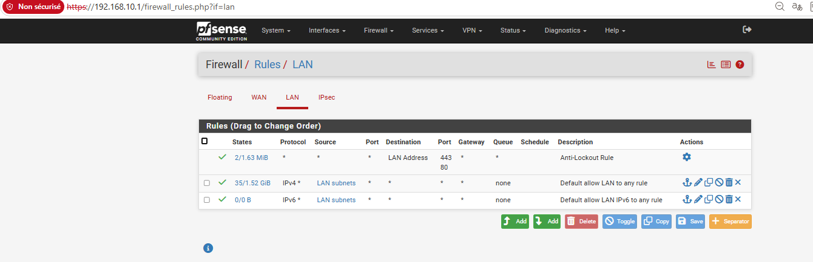
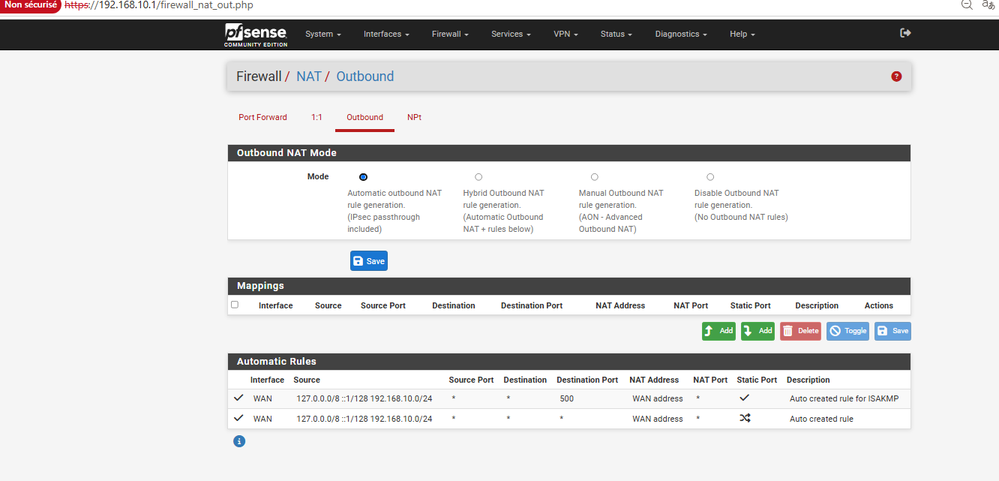
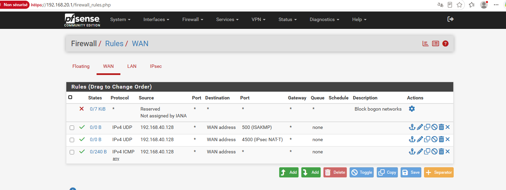
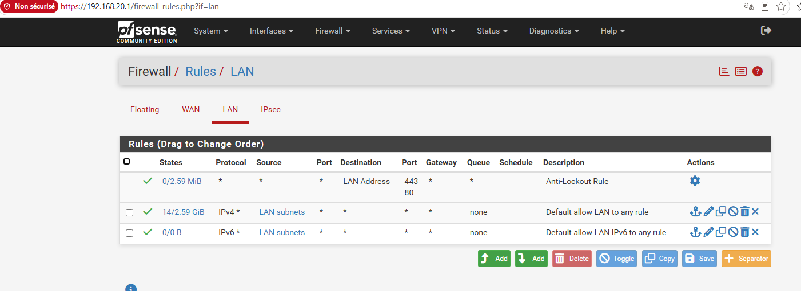

# 02 — pfSense et routage inter-sites

## 1. Objectif

Deux instances pfSense assurent la sécurité et le routage des réseaux locaux d'Amiens et de Paris. Elles servent également de points de terminaison au tunnel IPsec site-à-site (voir [03 — VPN IPsec](03-vpn-ipsec.md)).

## 2. Plateforme

| Élément | Valeur |
|---|---|
| Logiciel | pfSense Community Edition `2.9.0-RELEASE` (amd64), sur les deux sites |
| Hébergement | Machines virtuelles VMware |
| Ressources (VM relevée) | 512 Mo de RAM, 1 processeur, disque de 30 Go |
| Carte réseau 1 (WAN, VM relevée) | NAT VMware |
| Carte réseau 2 (LAN, VM relevée) | Segment LAN VMware `LAN-lab` |

Le tableau de bord d'Amiens affiche environ 451 MiB de mémoire disponible, ce qui est cohérent avec 512 Mo alloués.

## 3. Interfaces

| Pare-feu | Interface | Adresse | Réseau |
|---|---|---|---|
| pfSense Amiens | LAN | `192.168.10.1` | `192.168.10.0/24` |
| pfSense Amiens | WAN | `192.168.40.128` | `192.168.40.0/24` (réseau NAT de VMware) |
| pfSense Paris | LAN | `192.168.20.1` | `192.168.20.0/24` |
| pfSense Paris | WAN | `192.168.40.129` | `192.168.40.0/24` (même réseau de transit) |

L'adresse WAN d'Amiens provient de son tableau de bord ; celle de Paris est la passerelle distante déclarée dans le tunnel d'Amiens (`Status > IPsec`). Les deux pare-feu se joignent par leurs adresses WAN sur le réseau de transit `192.168.40.0/24`. Ces adresses sont privées : aucune adresse publique n'apparaît dans ce dépôt. Chaque poste utilise la passerelle de son propre site.

## 4. Routage

Le tunnel IPsec est configuré en mode **tunnel** : les sélecteurs de trafic de la phase 2 déclarent `192.168.10.0/24` et `192.168.20.0/24` comme réseaux local et distant. pfSense dirige donc dans le tunnel le trafic destiné au réseau de l'autre site. Aucune route statique n'a été documentée pour le routage inter-sites.

## 5. Règles de filtrage

### 5.1 pfSense Amiens

| Onglet | Règle | Détail |
|---|---|---|
| WAN | Block bogon networks | Règle par défaut |
| WAN | UDP 500 (ISAKMP) | Source `192.168.40.129` (WAN de Paris) vers l'adresse WAN |
| WAN | UDP 4500 (IPsec NAT-T) | Même source et même destination |
| WAN | ICMP | Source `192.168.40.129`, pour tester la joignabilité du pare-feu de Paris |
| IPsec | « Autoriser LAN Paris vers LAN Amiens » | IPv4 tous protocoles, `192.168.20.0/24` vers `192.168.10.0/24` |
| LAN | Anti-Lockout Rule | Accès à l'interface web (ports 443 et 80) |
| LAN | Default allow LAN to any | IPv4 et IPv6 |

### 5.2 pfSense Paris

| Onglet | Règle | Détail |
|---|---|---|
| WAN | Block bogon networks | Règle par défaut |
| WAN | UDP 500 (ISAKMP) et UDP 4500 (NAT-T) | Source `192.168.40.128` (WAN d'Amiens) vers l'adresse WAN |
| WAN | ICMP | Source `192.168.40.128` |
| IPsec | « Autoriser LAN Amiens vers LAN Paris » | IPv4 tous protocoles, `192.168.10.0/24` vers `192.168.20.0/24` |
| LAN | Anti-Lockout Rule | Accès à l'interface web (ports 443 et 80) |
| LAN | Default allow LAN to any | IPv4 et IPv6 |

Les règles de Paris sont le miroir de celles d'Amiens. Les compteurs d'états montrent du trafic réel dans le tunnel : 9,95 MiB sur la règle IPsec d'Amiens et 1,08 MiB sur celle de Paris.

### 5.3 NAT sortant

Mode **automatique** (*Automatic outbound NAT rule generation*) sur Amiens, avec les règles générées automatiquement pour ISAKMP.

### 5.4 Analyse

- Les flux WAN sont limités au strict nécessaire pour monter le tunnel : IKE (UDP 500), NAT-T (UDP 4500) et ICMP, uniquement depuis l'adresse du pair.
- Les règles de l'onglet IPsec et de l'onglet LAN autorisent **tous les protocoles et tous les ports** entre les deux LAN. C'est pratique dans un laboratoire, mais en production on se limiterait aux flux nécessaires : DNS, Kerberos, LDAP, SMB et ICMP de diagnostic (voir [11 — Évolutions et leçons](11-evolutions-et-lecons.md)).

## 6. Vérifications

Depuis un poste de Paris :
```cmd
ping 192.168.20.1
ping 192.168.10.20
nslookup srv-ad.lab.local 192.168.10.20
```

Un échec ICMP ne prouve pas nécessairement que le VPN est en panne : le filtrage peut bloquer les requêtes ping. Il faut aussi tester les services applicatifs concernés. Côté pfSense, `Status > IPsec` donne l'état du tunnel.

## 7. Captures


*Tableau de bord de pfSense Amiens : version `2.9.0`, interface LAN `192.168.10.1`, interface WAN `192.168.40.128`.*

Règles de pare-feu d'Amiens :


*Règles WAN d'Amiens : IKE, NAT-T et ICMP autorisés uniquement depuis le WAN de Paris.*


*Règles LAN d'Amiens : règle anti-verrouillage et autorisation du LAN vers toute destination.*


*NAT sortant d'Amiens en mode automatique.*

Règles de pare-feu de Paris :


*Règles WAN de Paris : miroir de celles d'Amiens.*


*Règles LAN de Paris.*

Les règles de l'onglet IPsec des deux sites sont présentées dans le document [03](03-vpn-ipsec.md).
