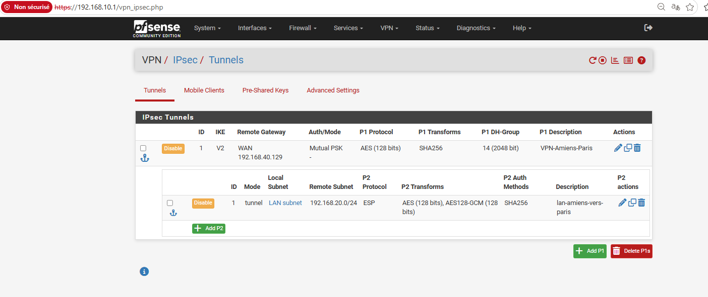
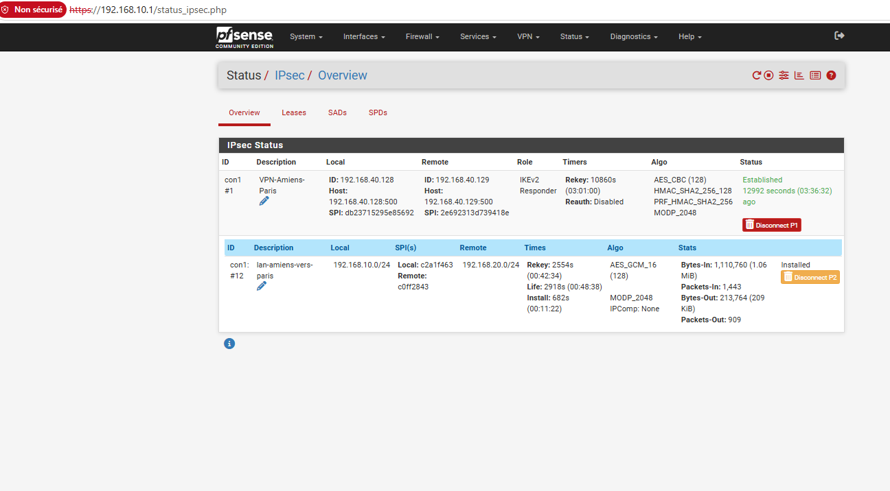
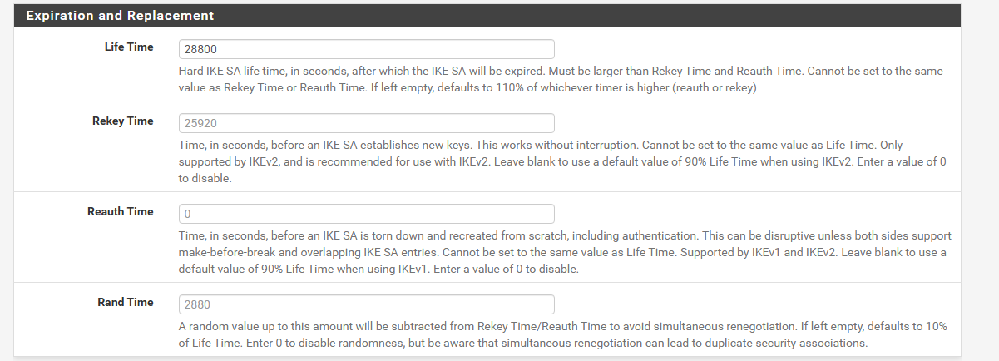
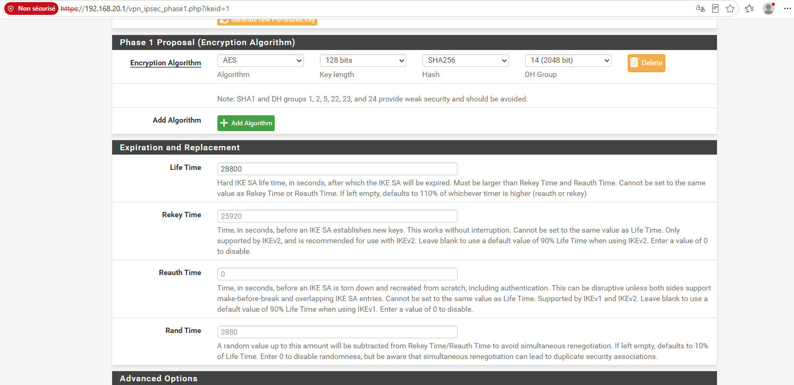
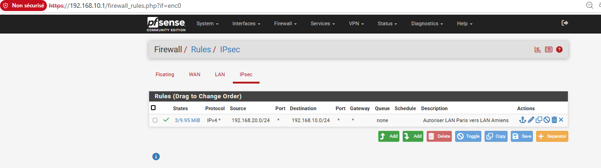
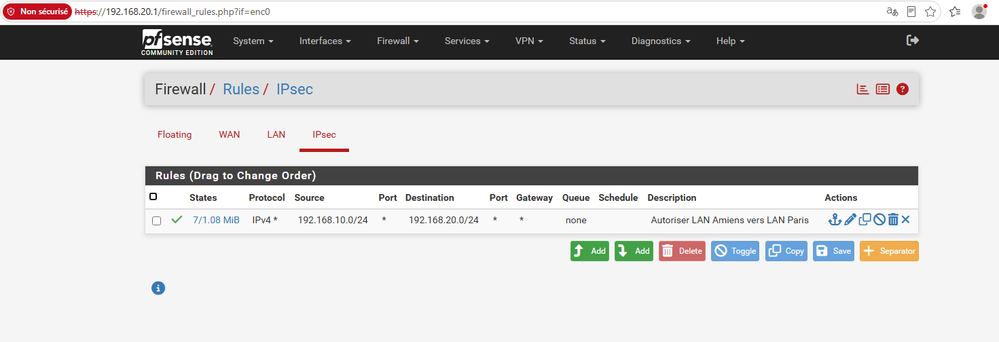

# 03 — VPN IPsec site-à-site

## 1. Objectif

Le VPN IPsec relie les deux réseaux privés du laboratoire. Il permet au poste du site de Paris d'accéder aux services hébergés à Amiens sans exposer directement les ressources internes.

## 2. Réseaux et extrémités

| Extrémité | Réseau local | Adresse WAN (transit) |
|---|---|---|
| pfSense Amiens | `192.168.10.0/24` | `192.168.40.128` |
| pfSense Paris | `192.168.20.0/24` | `192.168.40.129` |

Les deux pare-feu pfSense sont les extrémités du tunnel. Les adresses de transit sont privées (réseau NAT de VMware).

## 3. Principe de fonctionnement

IPsec protège les communications IP entre les deux passerelles. Avec IKEv2 et ESP :
- la **phase 1** (IKE SA) établit une association de sécurité et authentifie les pairs ;
- la **phase 2** (Child SA) définit les flux protégés entre les réseaux privés.

## 4. Paramètres configurés

### 4.1 Phase 1

| Paramètre | Amiens | Paris |
|---|---|---|
| Version IKE | IKEv2 | IKEv2 |
| Description | `VPN-Amiens-Paris` | Non relevée |
| Passerelle distante | `192.168.40.129` | `192.168.40.128` |
| Authentification | Mutual PSK (clé prépartagée) | Mutual PSK (clé prépartagée) |
| Identifiant local | Adresse IP du pare-feu (*My IP address*) | Identique |
| Identifiant du pair | Adresse IP du pair | Identique |
| Chiffrement | AES 128 bits | AES 128 bits |
| Hash | SHA256 | SHA256 |
| Groupe Diffie-Hellman | 14 (2048 bits) | 14 (2048 bits) |
| Durée de vie (*Life Time*) | 28 800 s (8 h) | 28 800 s (8 h) |
| *Rekey Time*, *Reauth Time*, *Rand Time* | Valeurs par défaut de pfSense (25 920 s, désactivé, 2 880 s) | Identiques |

Les valeurs de Paris relevées directement sur les captures sont les algorithmes (AES 128, SHA256, DH 14) et les durées de vie. Les autres valeurs de la colonne Paris (version IKE, passerelle distante, authentification, identifiants) sont déduites : un tunnel IKEv2 établi avec clé prépartagée impose des réglages symétriques sur les deux pare-feu, et la passerelle distante de Paris est l'adresse WAN d'Amiens.

### 4.2 Phase 2

| Paramètre | Valeur |
|---|---|
| Description | `lan-amiens-vers-paris` |
| Mode | Tunnel IPv4 |
| Réseau local (Amiens) | `192.168.10.0/24` (LAN subnet) |
| Réseau distant (Amiens) | `192.168.20.0/24` |
| Protocole | ESP |
| Algorithmes proposés | AES 128 bits et AES128-GCM 128 bits |
| Hash | SHA256 |
| Groupe PFS | 14 (2048 bits) |
| Durée de vie | 3 600 s (1 h), valeur par défaut de pfSense, déduite de `Status > IPsec` : 682 s écoulées depuis l'installation + 2 918 s de vie restante (voir section 5) |

La phase 2 de Paris n'a pas été capturée : elle est déduite comme le miroir de celle d'Amiens (réseaux local et distant inversés), puisqu'un tunnel établi impose des sélecteurs symétriques.

## 5. État observé du tunnel

D'après `Status > IPsec` sur pfSense Amiens :

| Élément | Valeur |
|---|---|
| État | **Established**, depuis 12 992 s (3 h 36) |
| Rôle d'Amiens | Responder (Paris initie la négociation) |
| Algorithmes phase 1 | AES-CBC 128, HMAC-SHA2-256-128, PRF HMAC-SHA2-256, MODP 2048 |
| Phase 2 | `lan-amiens-vers-paris`, `192.168.10.0/24` ↔ `192.168.20.0/24`, **Installed** |
| Algorithmes phase 2 | **AES-GCM 128** (algorithme négocié), MODP 2048, sans compression IPComp |
| Durées de la phase 2 | 682 s depuis l'installation, renégociation dans 2 554 s, expiration dans 2 918 s (soit 3 600 s au total) |
| Trafic | 1 443 paquets reçus (1,06 MiB), 909 paquets émis (209 KiB) |

Le chiffrement de la phase 2 négocié est AES-GCM, qui assure à la fois confidentialité et intégrité. Les compteurs d'états des règles du pare-feu (document [02](02-pfsense-et-routage.md)) confirment que du trafic circule dans le tunnel dans les deux sens.

## 6. Tests

Depuis le client de Paris :
```cmd
ping 192.168.10.20
nslookup srv-ad.lab.local 192.168.10.20
```

Puis les services réels, par exemple l'ouverture du partage :
```text
\\srv-ad.lab.local\Partages
```

## 7. Captures


*Tunnel `VPN-Amiens-Paris` en IKEv2, Mutual PSK, AES 128 / SHA256 / DH 14, avec sa phase 2 `lan-amiens-vers-paris`.*


*`Status > IPsec` : tunnel Established, phase 2 Installed, AES-GCM 128, avec les compteurs de trafic.*


*Durée de vie de la phase 1 à Amiens : 28 800 s.*


*Phase 1 de Paris : mêmes algorithmes et même durée de vie qu'à Amiens.*


*Règle de l'onglet IPsec d'Amiens : autorisation du LAN de Paris vers le LAN d'Amiens, avec le trafic observé.*


*Règle de l'onglet IPsec de Paris : autorisation du LAN d'Amiens vers le LAN de Paris.*
