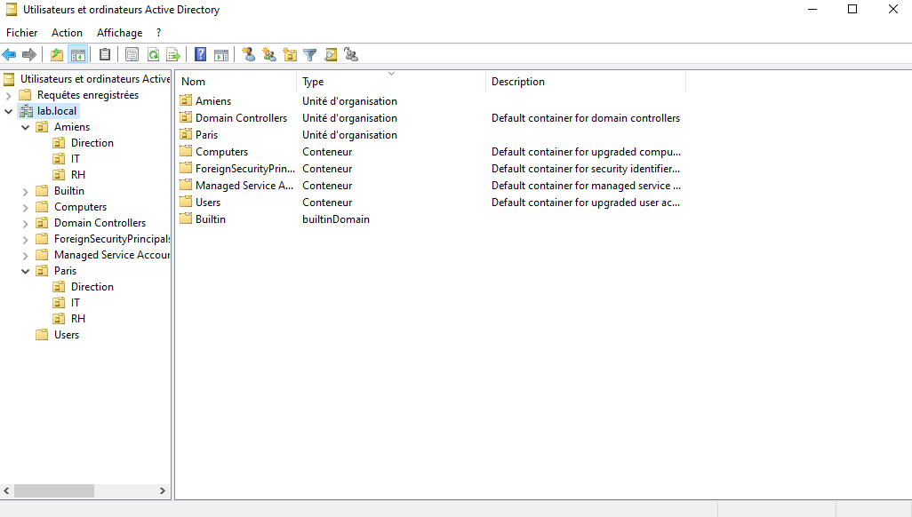
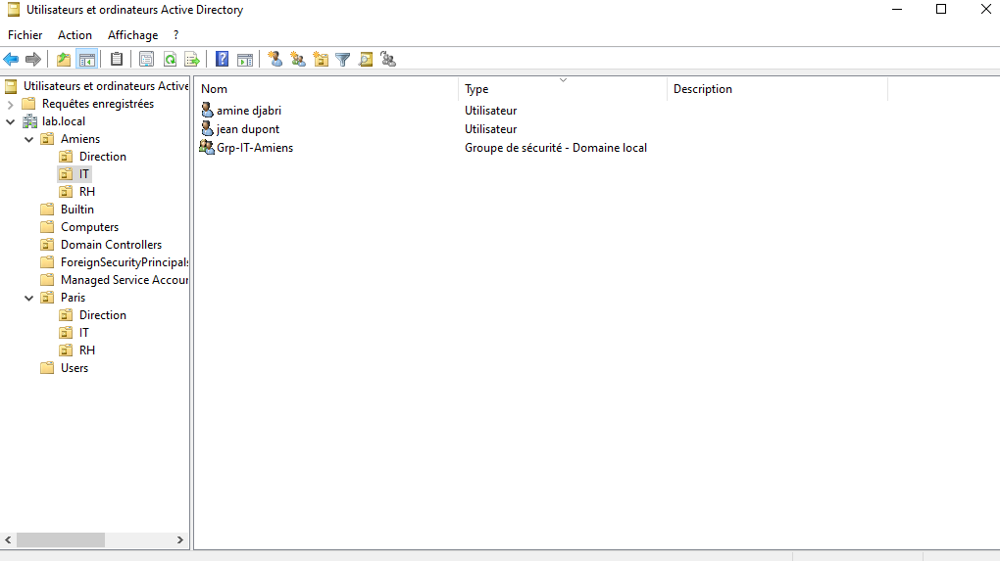
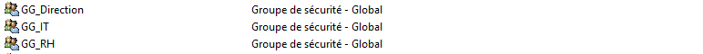

# 04 — Active Directory et DNS

## 1. Présentation

Le site d'Amiens héberge le serveur `srv-ad.lab.local`, configuré avec l'adresse statique `192.168.10.20/24`. Il fournit les services Active Directory Domain Services (AD DS) et DNS pour le domaine `lab.local`.

| Paramètre | Valeur |
|---|---|
| Nom du serveur | `srv-ad` |
| FQDN | `srv-ad.lab.local` |
| Domaine AD | `lab.local` |
| Adresse IPv4 | `192.168.10.20/24` |
| Passerelle | `192.168.10.1` |
| DNS utilisé par le domaine | `192.168.10.20` |

## 2. Rôle d'Active Directory

Active Directory centralise les objets du domaine :
- comptes utilisateurs ;
- groupes de sécurité ;
- comptes ordinateurs ;
- unités d'organisation (OU) ;
- stratégies de groupe associées.

Le domaine permet aux utilisateurs de s'authentifier sur les postes membres et d'accéder aux ressources selon leurs autorisations.

## 3. Organisation des unités d'organisation

Les OU créées dans le laboratoire sont les suivantes :

```text
lab.local
├── Amiens
│   ├── IT
│   ├── RH
│   └── Direction
├── Paris
│   ├── IT
│   ├── RH
│   └── Direction
└── Domain Controllers   (OU par défaut)
```



*Utilisateurs et ordinateurs Active Directory : les OU Amiens et Paris, chacune avec Direction, IT et RH.*

## 4. Utilisateurs et groupes de sécurité

Deux familles de groupes de sécurité sont utilisées.

| Groupe |  Usage |
|---|---|
| `GG_IT` |  Accès au dossier IT et lecteur `I:` |
| `GG_RH` | Accès au dossier RH et lecteur `R:` |
| `GG_Direction` |  Accès au dossier Direction et lecteur `T:` |
| `Grp-IT-Amiens` | Groupe du service IT pour le site d'Amiens  |
| `Grp-IT-Paris` | Groupe du service It pour le site de Paris  |
| `Grp-RH-Amiens` | Groupe du service RH pour le site d'Amiens  |
| `Grp-RH-Paris` | Groupe du service RH pour le site de Paris  |

Les groupes `GG_*` portent les droits des partages (voir [08 — Partages et permissions](08-partages-et-permissions.md)) et le ciblage de `GPO_Lecteurs_Reseau` (voir [09](09-mappage-des-lecteurs.md)). Les comptes utilisateurs sont membres du groupe correspondant à leur service. Les droits sont attribués aux groupes plutôt qu'individuellement aux utilisateurs.


*OU Amiens > IT : deux utilisateurs et le groupe de domaine local `Grp-IT-Amiens`.*


*Les trois groupes de sécurité globaux `GG_Direction`, `GG_IT` et `GG_RH`.*

## 5. DNS

Le serveur DNS AD héberge la résolution du domaine `lab.local`. Les clients des deux sites reçoivent `192.168.10.20` comme serveur DNS par DHCP (voir [05 — DHCP](05-dhcp.md)), afin de résoudre les enregistrements nécessaires à la découverte du domaine et à l'authentification.


Commandes de vérification :
```cmd
ipconfig /all
nslookup srv-ad.lab.local
nslookup lab.local
nslookup -type=SRV _ldap._tcp.dc._msdcs.lab.local
```

La résolution du nom `srv-ad.lab.local` doit retourner `192.168.10.20`.

## 6. Adhésion du client Paris au domaine

Le poste Windows de Paris a rejoint le domaine `lab.local`. Son adresse observée pendant les tests était `192.168.20.105`.

Après l'adhésion, l'authentification sur le domaine et l'application des stratégies de groupe ont été testées.

## 7. Contrôles utiles

Sur un poste client :
```cmd
whoami
echo %USERDOMAIN%
echo %LOGONSERVER%
gpresult /r
```

