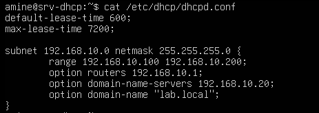
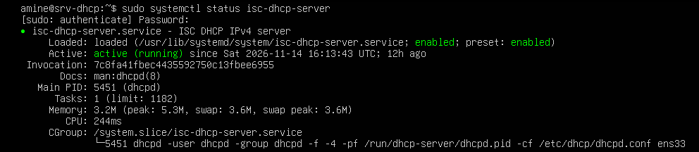
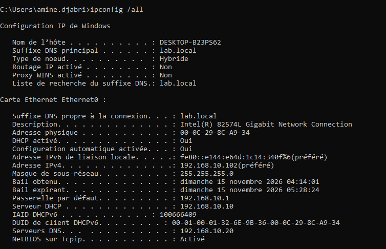
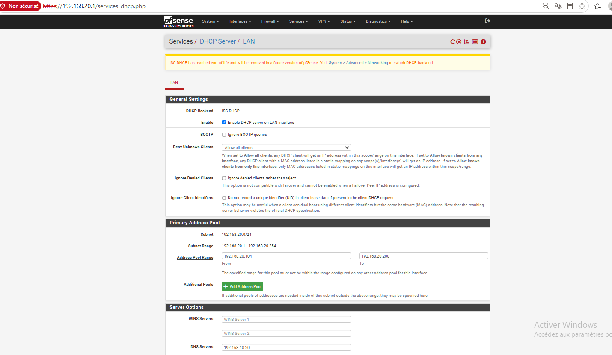
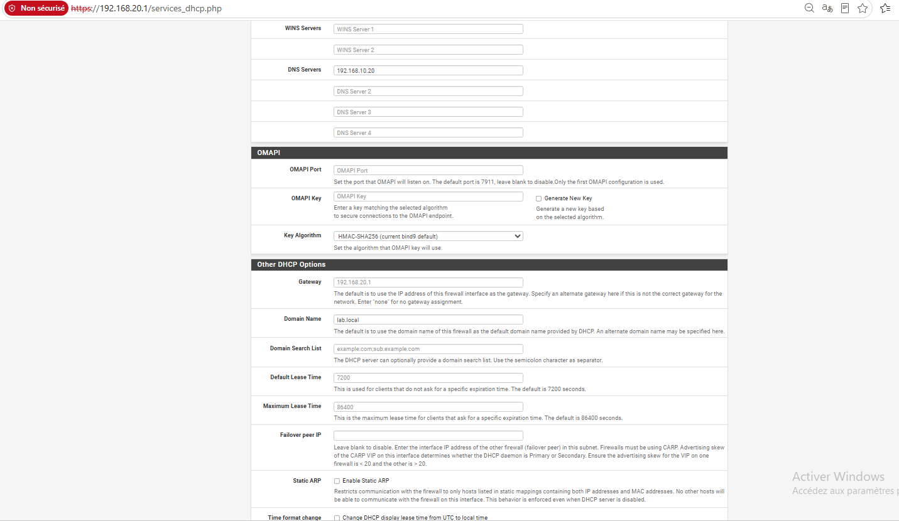

# 05 — DHCP

## 1. Objectif

Le protocole DHCP fournit automatiquement aux clients leur configuration IPv4 : adresse, masque, passerelle et serveur DNS.

Le laboratoire utilise un service DHCP par site :

| Site | Service DHCP | Hébergé sur | Réseau |
|---|---|---|---|
| Amiens | `isc-dhcp-server` | VM Ubuntu Server `srv-dhcp` (`192.168.10.10`) | `192.168.10.0/24` |
| Paris | DHCP pfSense | pfSense Paris | `192.168.20.0/24` |

Dans les deux cas, les clients reçoivent le DNS Active Directory (`192.168.10.20`) et le suffixe `lab.local`.

## 2. DHCP du site d'Amiens — `srv-dhcp`

### 2.1 Serveur

| Paramètre | Valeur |
|---|---|
| Nom | `srv-dhcp` |
| Système | Ubuntu Server 26.04 LTS |
| Interface réseau | `ens33` |
| Adresse IPv4 (statique) | `192.168.10.10/24` |
| Passerelle | `192.168.10.1` |
| DNS | `192.168.10.20` |
| Logiciel | `isc-dhcp-server` |

L'adresse est fixe : les clients doivent toujours pouvoir joindre le serveur DHCP. Cette machine ne fait que du DHCP ; le DNS du domaine est géré par `srv-ad` (voir la section 4).

Plan d'adressage du réseau d'Amiens :

| Adresse ou plage | Usage |
|---|---|
| `192.168.10.1` | pfSense (passerelle) |
| `192.168.10.10` | `srv-dhcp` |
| `192.168.10.20` | `srv-ad` |
| `192.168.10.100` – `192.168.10.200` | Pool DHCP des clients |

### 2.2 Installation

```bash
sudo apt install isc-dhcp-server -y
```

Le LAN du laboratoire étant isolé, un accès Internet temporaire (NAT VMware) a été nécessaire pour télécharger le paquet.

### 2.3 Fichier `/etc/dhcp/dhcpd.conf`

```conf
default-lease-time 600;
max-lease-time 7200;

subnet 192.168.10.0 netmask 255.255.255.0 {
  range 192.168.10.100 192.168.10.200;
  option routers 192.168.10.1;
  option domain-name-servers 192.168.10.20;
  option domain-name "lab.local";
}
```

| Directive | Rôle |
|---|---|
| `default-lease-time 600` | Durée de bail par défaut : 600 s (10 min) |
| `max-lease-time 7200` | Durée de bail maximale : 7200 s (2 h) |
| `subnet … netmask …` | Réseau pour lequel le serveur distribue des adresses |
| `range` | Pool d'adresses distribuées dynamiquement |
| `option routers` | Passerelle transmise aux clients |
| `option domain-name-servers` | Serveur DNS transmis aux clients (`srv-ad`) |
| `option domain-name` | Suffixe DNS transmis aux clients |

Les baux courts sont pratiques en laboratoire pour observer les renouvellements ; en production, on utiliserait des durées plus longues.


*Contenu de `/etc/dhcp/dhcpd.conf` sur `srv-dhcp`.*

### 2.4 Interface d'écoute

Fichier `/etc/default/isc-dhcp-server` :

```conf
INTERFACESv4="ens33"
```

Cette ligne limite l'écoute du service à l'interface du LAN. Sans elle, `dhcpd` détermine lui-même les interfaces à partir des sous-réseaux déclarés.

### 2.5 Démarrage et validation du service

```bash
sudo dhcpd -t -cf /etc/dhcp/dhcpd.conf
sudo systemctl enable --now isc-dhcp-server
sudo systemctl status isc-dhcp-server
```

- `dhcpd -t` vérifie la syntaxe du fichier sans démarrer le service ;
- le statut attendu est `Active: active (running)` ;
- les journaux (`sudo journalctl -u isc-dhcp-server`) doivent indiquer l'écoute sur `ens33` (`Listening on LPF/ens33/…/192.168.10.0/24`), puis `Server starting service`.


*Le service est `active (running)`, activé au démarrage, et écoute sur `ens33`.*

### 2.6 Résultat observé

| Client | Adresse obtenue | Mode |
|---|---|---|
| Client Linux | `192.168.10.101/24` | Dynamique (DHCP) |
| Client Windows | `192.168.10.102/24` | Dynamique (DHCP) |

Les clients reçoivent également la passerelle `192.168.10.1`, le DNS `192.168.10.20` et le suffixe `lab.local`. Le serveur DHCP identifié côté client est `192.168.10.10`.


*`ipconfig /all` sur le client Windows d'Amiens : DHCP activé, adresse `192.168.10.102`, serveur DHCP `192.168.10.10`, DNS `192.168.10.20`, suffixe `lab.local`.*

## 3. DHCP du site de Paris — pfSense

Le service DHCP du site de Paris est assuré par **pfSense Paris** (`Services > DHCP Server`, onglet de l'interface LAN). Le backend utilisé est **ISC DHCP**, que pfSense signale comme arrivé en fin de vie (une migration vers un autre backend est possible dans `System > Advanced > Networking`).

| Option | Valeur | Origine |
|---|---|---|
| Réseau Paris | `192.168.20.0/24` | |
| Plage distribuée | `192.168.20.104` – `192.168.20.200` | Saisi |
| DNS distribué | `192.168.10.20` | Saisi |
| Suffixe DNS (*Domain Name*) | `lab.local` | Saisi |
| Passerelle | `192.168.20.1` | Valeur par défaut (adresse LAN de pfSense) |
| Durée de bail par défaut | `7200` s (2 h) | Valeur par défaut |
| Durée de bail maximale | `86400` s (24 h) | Valeur par défaut |
| Clients inconnus | `Allow all clients` | |
| Réservations statiques | Aucune | |

Le client Windows de Paris a obtenu l'adresse `192.168.20.105`, située dans la plage.

Le DNS distribué est celui d'Active Directory, situé sur le site d'Amiens : les requêtes DNS des clients de Paris traversent donc la liaison VPN entre les deux sites.


*Service DHCP de pfSense Paris : réseau `192.168.20.0/24`, plage `192.168.20.104` – `192.168.20.200`.*


*Options distribuées : DNS `192.168.10.20`, suffixe `lab.local`, durées de bail par défaut.*


## 5. Vérification

### 5.1 Client Windows

```cmd
ipconfig /all
ipconfig /release
ipconfig /renew
ipconfig /flushdns
```

Vérifier :
- l'adresse IPv4 ;
- le masque ;
- la passerelle par défaut ;
- le serveur DHCP ;
- le serveur DNS ;
- le suffixe DNS.

### 5.2 Client Linux

```bash
ip a
resolvectl status
```

`ip a` doit montrer une adresse du pool, marquée `dynamic`. `resolvectl status` doit indiquer `192.168.10.20` comme serveur DNS.

### 5.3 Serveur `srv-dhcp`

```bash
sudo systemctl status isc-dhcp-server
sudo journalctl -u isc-dhcp-server -n 20
sudo cat /var/lib/dhcp/dhcpd.leases
```

Le fichier `dhcpd.leases` liste les baux accordés (adresse, adresse MAC, dates de début et de fin).

## 6. Problèmes rencontrés et solutions

| Problème | Cause | Solution |
|---|---|---|
| Le service `isc-dhcp-server` passe en `failed` | Faute de frappe dans `dhcpd.conf` (`max-lease-tim`) | Correction en `max-lease-time`, puis validation avec `dhcpd -t -cf` avant le redémarrage |
| Installation du paquet impossible | LAN isolé : dépôts inaccessibles | Accès Internet temporaire (NAT), route par défaut corrigée vers la passerelle NAT, puis retour sur le LAN Segment |
| Jonction au domaine impossible | Le DNS distribué était BIND9, sans les enregistrements SRV d'Active Directory | DHCP et clients pointés sur le DNS d'`srv-ad` (`192.168.10.20`) ; BIND9 abandonné |

