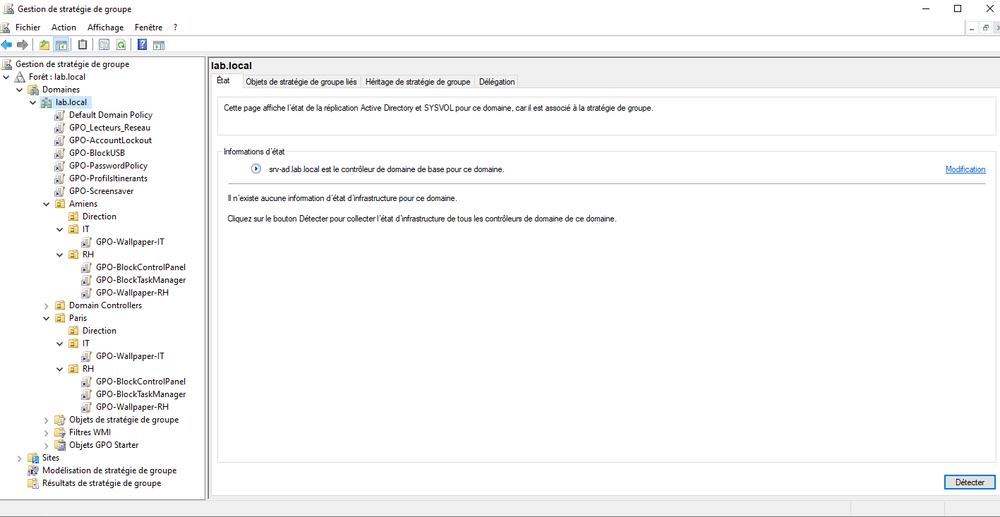
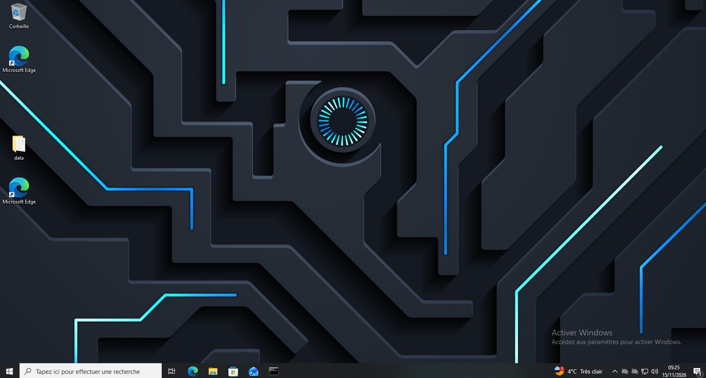
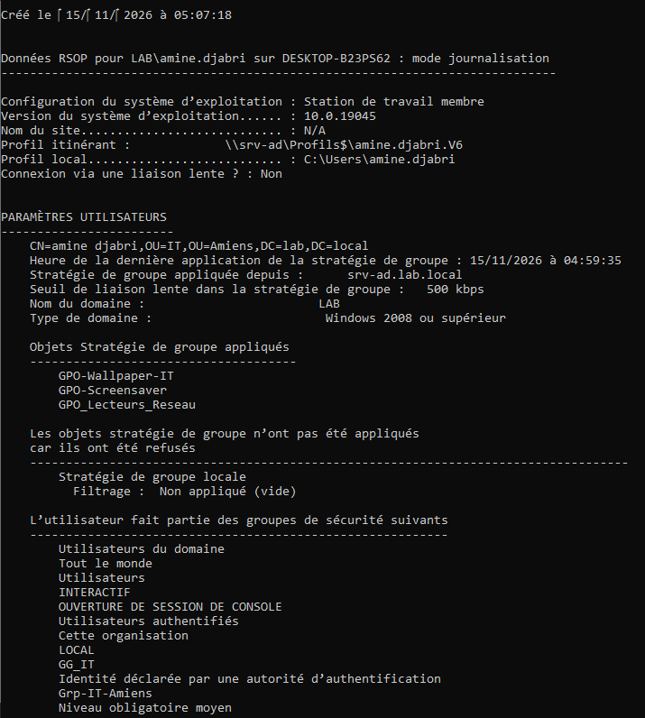
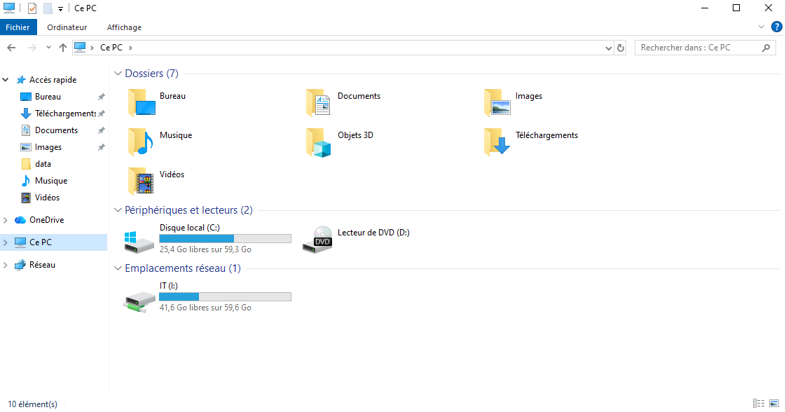

# 06 — Stratégies de groupe et administration

## 1. Objectif

Les stratégies de groupe (GPO) permettent d'appliquer de manière centralisée des paramètres aux utilisateurs et aux ordinateurs du domaine.

Cette documentation décrit le mécanisme, l'inventaire des GPO du laboratoire et le détail de leur configuration.

## 2. Organisation et ordre d'application

Les OU du domaine distinguent les sites Amiens et Paris, puis les services IT, RH et Direction. Les GPO peuvent être liées à une OU ou au domaine selon le besoin.

Une GPO liée au domaine s'applique aux utilisateurs concernés des deux sites, sous réserve du filtrage de sécurité, de l'héritage et de l'emplacement des comptes.

Ordre d'application : stratégie locale, puis site, puis domaine, puis OU. En cas de conflit, la GPO la plus proche de l'objet l'emporte, sauf si une GPO située plus haut est configurée en **Appliqué** (Enforced).

- les paramètres de **configuration utilisateur** dépendent de l'emplacement du compte utilisateur ;
- les paramètres de **configuration ordinateur** dépendent de l'emplacement du compte ordinateur.

## 3. Inventaire des GPO

Le laboratoire compte **10 GPO personnalisées**, en plus des deux GPO par défaut (`Default Domain Policy` et `Default Domain Controllers Policy`).

| GPO | Lien | Portée | Effet |
|---|---|---|---|
| `GPO-Wallpaper-IT` | OU IT d'Amiens et OU IT de Paris | Utilisateur | Fond d'écran du service IT |
| `GPO-Wallpaper-RH` | OU RH d'Amiens et OU RH de Paris | Utilisateur | Fond d'écran du service RH |
| `GPO-BlockControlPanel` | OU RH d'Amiens et OU RH de Paris | Utilisateur | Accès interdit au Panneau de configuration |
| `GPO-BlockTaskManager` | OU RH d'Amiens et OU RH de Paris | Utilisateur | Gestionnaire des tâches bloqué (objectif déduit de son nom) |
| `GPO-PasswordPolicy` | Domaine `lab.local` | Ordinateur | Longueur minimale, complexité et expiration des mots de passe |
| `GPO-AccountLockout` | Domaine `lab.local` | Ordinateur | Verrouillage du compte après plusieurs échecs |
| `GPO-BlockUSB` | Domaine `lab.local` | Ordinateur | Refus d'accès aux disques amovibles |
| `GPO-Screensaver` | Domaine `lab.local` | Utilisateur | Écran de veille verrouillé par mot de passe |
| `GPO_Lecteurs_Reseau` | Domaine `lab.local` | Utilisateur (préférences) | Lecteurs réseau selon l'appartenance aux groupes `GG_*` |
| `GPO-ProfilsItinerants` | Domaine `lab.local` | Ordinateur | Profils itinérants |

Les OU **Direction** des deux sites n'ont pas de GPO spécifique liée : leurs utilisateurs reçoivent seulement les GPO du domaine.



*Console de gestion des stratégies de groupe : les GPO du domaine (haut) et celles liées aux OU IT et RH d'Amiens et de Paris.*

## 4. Détail des GPO

### 4.1 Fonds d'écran par service

Une GPO par service (IT et RH), liée aux OU correspondantes d'Amiens et de Paris.

Emplacement de configuration :
`Configuration utilisateur > Modèles d'administration > Bureau > Bureau > Papier peint du Bureau`

| Paramètre | Valeur |
|---|---|
| État | Activé |
| Nom du papier peint | Chemin UNC vers une image du partage `\\srv-ad\Wallpapers` |
| Style | Remplissage |

Le chemin doit être accessible depuis le poste client. Un chemin local au serveur (`C:\Wallpapers`) ne fonctionne pas, car le client le cherche sur son propre disque. Les images sont donc placées dans un dossier partagé `\\srv-ad\Wallpapers`.



*Bureau d'un compte du service IT.*


*Bureau d'un compte du service RH.*


### 4.2 Politique de mots de passe — `GPO-PasswordPolicy`

Emplacement de configuration :
`Configuration ordinateur > Paramètres Windows > Paramètres de sécurité > Stratégies de compte > Stratégie de mot de passe`

| Paramètre | Valeur |
|---|---|
| Longueur minimale du mot de passe | 8 caractères |
| Le mot de passe doit respecter des exigences de complexité | Activé |
| Âge maximal du mot de passe | 90 jours |

### 4.3 Verrouillage de compte — `GPO-AccountLockout`

Emplacement de configuration :
`Configuration ordinateur > Paramètres Windows > Paramètres de sécurité > Stratégies de compte > Stratégie de verrouillage du compte`

| Paramètre | Valeur |
|---|---|
| Seuil de verrouillage du compte | 3 tentatives non valides |
| Durée de verrouillage du compte | 30 minutes |


### 4.4 Blocage des clés USB — `GPO-BlockUSB`

Emplacement de configuration :
`Configuration ordinateur > Modèles d'administration > Système > Accès au stockage amovible`

| Paramètre | Valeur |
|---|---|
| Disques amovibles : refuser l'accès en lecture | Activé |
| Disques amovibles : refuser l'accès en écriture | Activé |

### 4.5 Écran de veille — `GPO-Screensaver`

Emplacement de configuration :
`Configuration utilisateur > Modèles d'administration > Panneau de configuration > Personnalisation`

| Paramètre | Valeur |
|---|---|
| Activer l'écran de veille | Activé |
| Protéger l'écran de veille par mot de passe | Activé |
| Délai d'attente de l'écran de veille | 600 secondes (10 minutes) |

### 4.6 Restrictions du service RH — `GPO-BlockControlPanel` et `GPO-BlockTaskManager`

`GPO-BlockControlPanel` — emplacement de configuration :
`Configuration utilisateur > Modèles d'administration > Panneau de configuration > Interdire l'accès au Panneau de configuration et aux paramètres du PC`

| Paramètre | Valeur |
|---|---|
| État | Activé |

`GPO-BlockTaskManager` vise à empêcher les utilisateurs RH d'ouvrir le Gestionnaire des tâches (objectif déduit de son nom). Le paramètre habituel correspondant se trouve dans `Configuration utilisateur > Modèles d'administration > Système > Options Ctrl+Alt+Suppr > Supprimer le Gestionnaire des tâches`.

Ces deux GPO concernent les deux services RH : chacune est liée à l'OU RH d'Amiens et à l'OU RH de Paris (**Lier un objet de stratégie de groupe existant** dans la console), soit une seule GPO avec deux liens.

### 4.7 Profils itinérants — `GPO-ProfilsItinerants`

Cette GPO est liée au domaine et apparaît dans les paramètres ordinateur de `srv-ad` d'après `gpresult /r`. Elle concerne les profils itinérants hébergés dans le partage `\\srv-ad\Profils$` (voir [07 — Profils itinérants](07-profils-itinerants.md)).

## 5. GPO de lecteurs réseau

Nom : `GPO_Lecteurs_Reseau`

Emplacement de configuration :
`Configuration utilisateur > Préférences > Paramètres Windows > Mappages de lecteurs`

Cette GPO utilise le ciblage au niveau de l'élément selon l'appartenance à un groupe de sécurité AD.

| Groupe de sécurité | Lettre | Étiquette | Chemin UNC |
|---|---:|---|---|
| `GG_IT` | `I:` | IT | `\\srv-ad.lab.local\Partages\IT` |
| `GG_RH` | `R:` | Ressources Humaines | `\\srv-ad.lab.local\Partages\RH` |
| `GG_Direction` | `T:` | Direction | `\\srv-ad.lab.local\Partages\Direction` |

Action utilisée : **Mettre à jour**. Elle crée le lecteur s'il n'existe pas et met à jour sa configuration lors de l'application de la préférence.

L'option de reconnexion est activée.

## 6. Ciblage au niveau de l'élément

Chaque lecteur est associé à une condition de groupe de sécurité :
- lecteur I: : utilisateur membre de `GG_IT` ;
- lecteur R: : utilisateur membre de `GG_RH` ;
- lecteur T: : utilisateur membre de `GG_Direction`.

L'utilisateur reçoit ainsi le lecteur correspondant à son groupe.

## 7. Actualisation et vérification

Sur un poste client :

```cmd
gpupdate /force
gpresult /r
gpresult /h C:\rapport-gpo.html
net accounts /domain
```

- `gpresult /r` liste les GPO appliquées à l'utilisateur et à l'ordinateur ;
- `gpresult /h` génère un rapport HTML détaillé ;
- `net accounts /domain` affiche la stratégie de mot de passe et de verrouillage effectivement appliquée au domaine.

Une déconnexion/reconnexion est nécessaire pour les paramètres de configuration utilisateur (fond d'écran, lecteurs) et pour que les changements d'appartenance aux groupes soient pris en compte dans le jeton d'ouverture de session. Certains paramètres de configuration ordinateur peuvent demander un redémarrage.

## 8. Tests de validation

| Test | Résultat attendu |
|---|---|
| Ouvrir une session avec un compte IT d'Amiens | Fond d'écran du service IT ; lecteur `I:` |
| Ouvrir une session avec un compte RH | Fond d'écran du service RH ; lecteur `R:` ; Panneau de configuration inaccessible |
| Ouvrir une session avec un compte Direction | Lecteur `T:` (pas de GPO spécifique de fond d'écran) |
| Saisir 3 mots de passe erronés | Compte verrouillé 30 minutes ; déverrouillage possible dans Active Directory |
| Brancher une clé USB sur un poste du domaine | Accès refusé |
| Laisser la session inactive 10 minutes | Écran verrouillé, mot de passe demandé |
| `net accounts /domain` | Longueur minimale 8, âge maximal 90 jours, seuil de verrouillage 3 |

### Résultats observés

**Poste client Windows (compte du service IT d'Amiens)** — `gpresult /r` :

| Élément | Valeur observée |
|---|---|
| Système | Windows 10 (build 10.0.19045), station de travail membre du domaine |
| Utilisateur | Compte situé dans l'OU Amiens > IT |
| GPO utilisateur appliquées | `GPO-Wallpaper-IT`, `GPO-Screensaver`, `GPO_Lecteurs_Reseau` |
| Groupes | `GG_IT` et `Grp-IT-Amiens` |
| Profil itinérant | `\\srv-ad\Profils$\<compte>.V6` |


*`gpresult /r` sur le poste client : les GPO du service IT sont appliquées, et l'utilisateur est membre de `GG_IT`.*

**Contrôleur de domaine `srv-ad` (compte `administrateur`)** — `gpresult /r` :

| Portée | GPO appliquées |
|---|---|
| Ordinateur `SRV-AD` | `Default Domain Controllers Policy`, `Default Domain Policy`, `GPO-PasswordPolicy`, `GPO-AccountLockout`, `GPO-BlockUSB`, `GPO-ProfilsItinerants` |
| Utilisateur `administrateur` | `GPO-Screensaver`, `GPO_Lecteurs_Reseau` |



*Le lecteur `IT (I:)` apparaît dans « Ce PC » : il est attribué par `GPO_Lecteurs_Reseau` au membre de `GG_IT`.*
