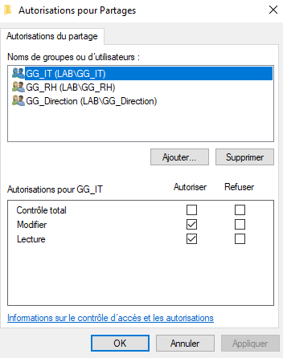
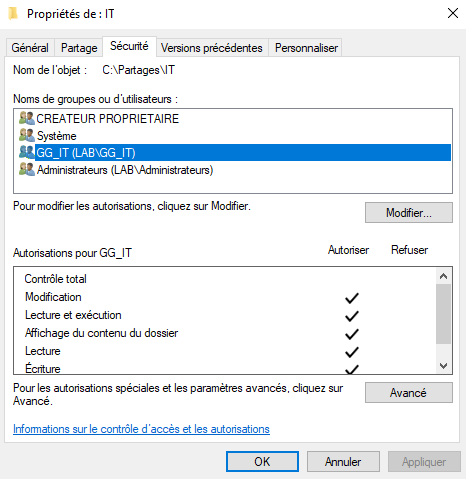

# 08 — Partages réseau et permissions

## 1. Objectif

Un partage centralisé est hébergé sur le serveur `srv-ad` afin de mettre à disposition des dossiers propres aux services IT, RH et Direction.

Les autorisations sont gérées avec des groupes de sécurité AD. La sécurité effective résulte de la combinaison des permissions de partage SMB et des permissions NTFS : c'est la plus restrictive des deux qui s'applique.

## 2. Arborescence sur le serveur

```text
C:\Partages
├── IT
├── RH
└── Direction
```

Le dossier parent est partagé sous le nom `Partages`.

Chemin UNC :
```text
\\srv-ad.lab.local\Partages
```

## 3. Groupes utilisés

| Groupe | Dossier associé |
|---|---|
| `GG_IT` | `C:\Partages\IT` |
| `GG_RH` | `C:\Partages\RH` |
| `GG_Direction` | `C:\Partages\Direction` |

Les utilisateurs sont ajoutés au groupe correspondant à leur service.

## 4. Partages SMB hébergés sur `srv-ad`

Relevé avec `Get-SmbShare` et `Get-SmbShareAccess` :

| Partage | Chemin | Permissions de partage |
|---|---|---|
| `Partages` | `C:\Partages` | `GG_IT`, `GG_RH`, `GG_Direction` : Modification |
| `Profils$` | `C:\Profils` | Tout le monde : Contrôle total (voir [07](07-profils-itinerants.md)) |
| `Wallpapers` | `C:\Wallpapers` | Tout le monde : Lecture |

Les partages `ADMIN$`, `C$`, `IPC$`, `NETLOGON` et `SYSVOL` sont les partages système par défaut.


*Permissions du partage `Partages` : `GG_IT`, `GG_RH` et `GG_Direction` avec Modifier et Lecture. Seul le dossier parent est partagé ; les droits par service se règlent en NTFS.*

Sur `Partages`, les trois groupes disposent du droit de **Modification** au niveau du partage. Aucune entrée spécifique n'a été ajoutée pour le groupe Administrateurs sur ce partage. Ces permissions autorisent l'accès réseau au partage, mais ne donnent pas à elles seules le droit d'ouvrir tous les sous-dossiers.

## 5. Permissions NTFS

Relevé avec `icacls` :

| Dossier | Entrées NTFS | Héritage |
|---|---|---|
| `C:\Partages\IT` | `GG_IT` : Modification ; Système, Administrateurs : Contrôle total ; Créateur propriétaire : Contrôle total (sous-éléments) | Désactivé |
| `C:\Partages\RH` | `GG_RH` : Modification ; mêmes entrées système | Désactivé |
| `C:\Partages\Direction` | `GG_Direction` : Modification ; mêmes entrées système | Désactivé |
| `C:\Wallpapers` | Utilisateurs du domaine : Lecture et exécution ; Système, `administrateur`, Administrateurs : Contrôle total | Désactivé |



*Onglet Sécurité de `C:\Partages\IT` : `GG_IT` en Modification, avec Système, Administrateurs et Créateur propriétaire.*

Le dossier `C:\Wallpapers` a été durci : l'entrée « Tout le monde » en contrôle total a été remplacée par une lecture seule pour les utilisateurs du domaine (principe du moindre privilège).

Le dossier parent `C:\Partages` conserve les droits hérités de `C:\` : le groupe Utilisateurs y a la lecture ainsi que la création de dossiers et de fichiers. Cela n'affecte pas les trois dossiers de service, qui sont verrouillés, mais le parent pourrait être durci à son tour.

## 6. Résultat des tests

Depuis le client Windows de Paris :
- le partage `\\srv-ad.lab.local\Partages` est accessible ;
- les trois dossiers peuvent être visibles dans l'explorateur ;
- un utilisateur ne peut ouvrir que le dossier autorisé à son groupe ;
- l'accès aux dossiers non autorisés est refusé.

La visibilité d'un nom de dossier ne signifie donc pas que l'utilisateur possède le droit de lire son contenu.


